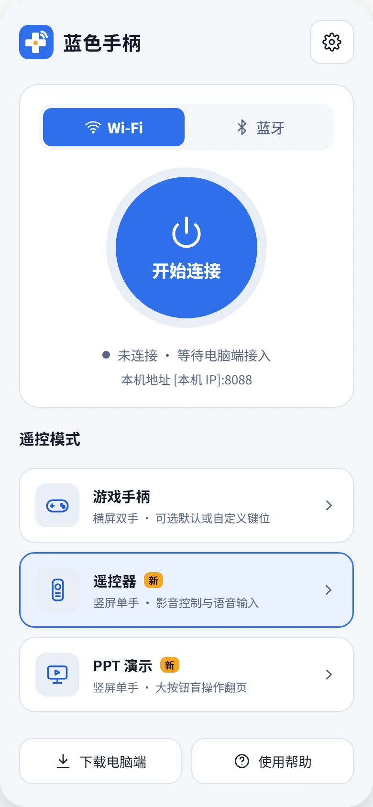
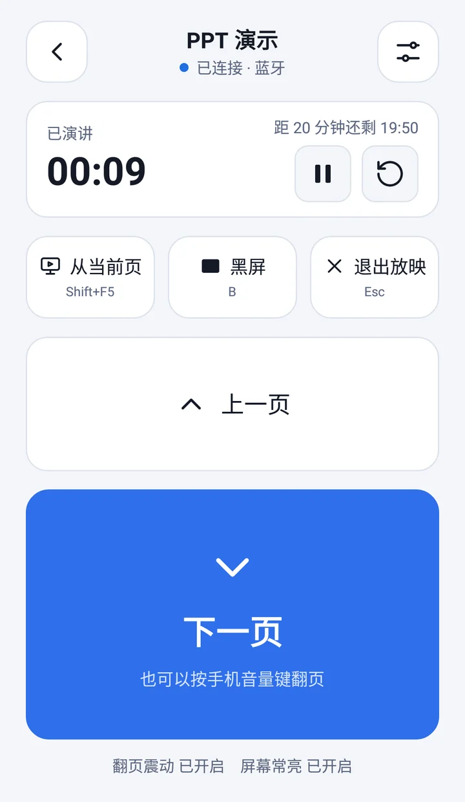
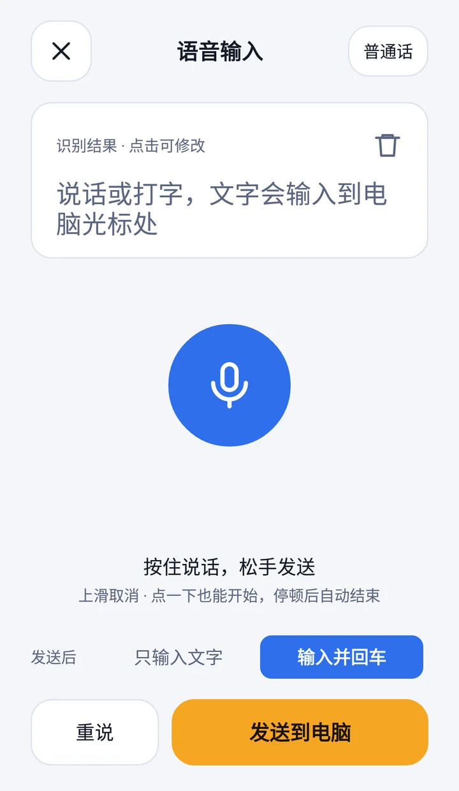
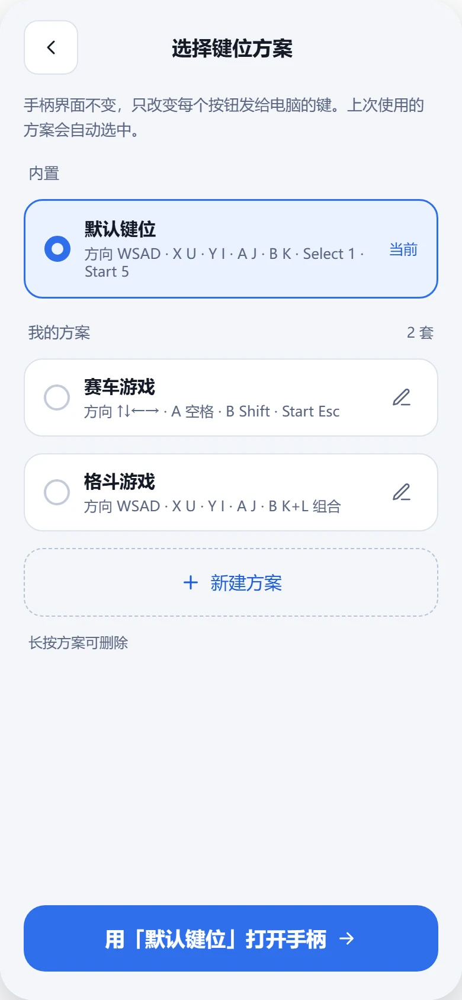
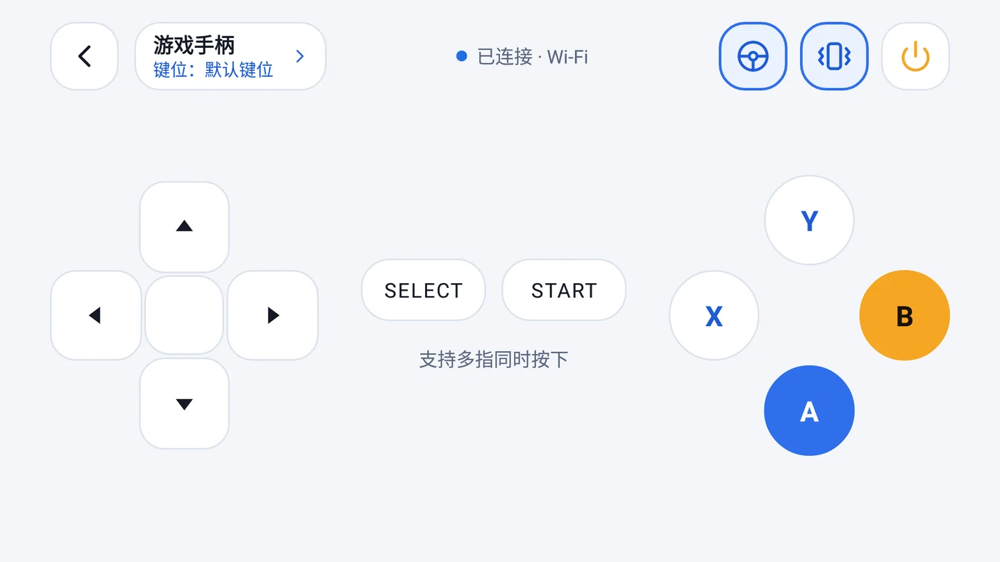
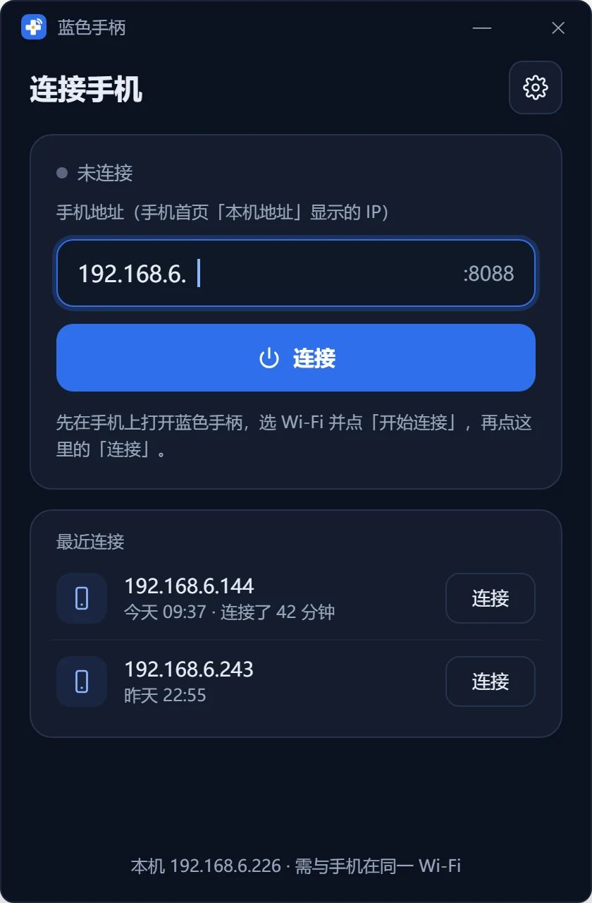
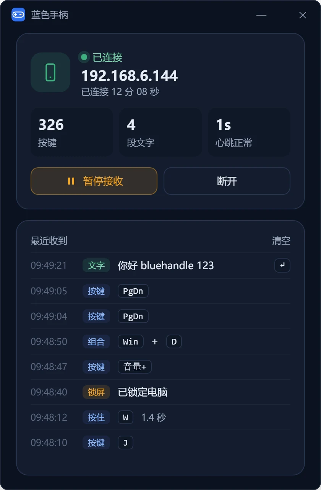

# BlueHandle (蓝色手柄)

[简体中文](README.md) | English

Turn your phone into a gamepad, remote control and keyboard for your PC. The phone and the PC talk directly over Wi‑Fi or Bluetooth — no server in between.

> The app's interface is currently available in Simplified Chinese only.

  <picture><source media="(prefers-color-scheme: dark)" srcset="website/assets/screens/main.webp"></picture>
  <picture><source media="(prefers-color-scheme: dark)" srcset="website/assets/screens/ppt.webp"></picture>
  <picture><source media="(prefers-color-scheme: dark)" srcset="website/assets/screens/tvvoice.webp"></picture>
  <picture><source media="(prefers-color-scheme: dark)" srcset="website/assets/screens/gamepadscheme.webp"></picture>

  <picture><source media="(prefers-color-scheme: dark)" srcset="website/assets/screens/gamepad.webp"></picture>

- **Gamepad**: landscape, two hands — D‑pad, A / B / X / Y, Select and Start. Multi‑touch, tilt control, and a separate key‑mapping profile per game; each button can send a combination of up to 3 keys.
- **PC remote**: portrait, one hand — arrows, OK, Back, volume, media playback, lock screen, show desktop, switch windows, page up/down, plus a numeric keypad. Hook your PC up to a TV or projector and control it from the couch.
- **Presentation**: big page‑turn buttons, and the phone's volume keys turn pages too. A talk timer vibrates when 2 minutes remain. Start from the current slide, black out the screen or end the show with one tap.
- **Voice input**: hold to talk, release, and the text is typed at the PC's current cursor position — optionally followed by Enter.

Light and dark themes are supported; by default the app follows the system setting.

## Download

Install both the phone app and the PC app:

| | Download | Requirements |
|---|---|---|
| Phone | [GitHub Releases](https://github.com/bluehandle-open/bluehandle/releases/latest) | Android 4.1+ |
| PC | [GitHub Releases](https://github.com/bluehandle-open/bluehandle-go/releases/latest) | Windows 10 / 11 |

The PC app's source code lives in [bluehandle-go](https://github.com/bluehandle-open/bluehandle-go).

## Quick start

1. Run `bluehandle.exe` on your PC.
2. Open BlueHandle on your phone, choose Wi‑Fi or Bluetooth, and tap 开始连接 (Connect).
   - Wi‑Fi: put the phone and the PC on the same network, then enter the address shown on the phone's home screen into the PC app (default port 8088).
   - Bluetooth: pair the phone with the PC in system settings first, then pick the phone from the PC app's Bluetooth list.
3. Once connected, choose a mode on the home screen. Switching modes or going back home keeps the connection alive.

  
  

See the user manual [`website/manual.html`](website/manual.html) (Chinese) for details.

## FAQ

**The PC app says "connection timed out"**

- Make sure the phone and the PC are behind the same router (a wired PC with a Wi‑Fi phone is fine).
- A "guest network" or "AP isolation" on the router blocks devices from reaching each other — switch to the main network or turn isolation off.
- Proxies, VPNs or security software on the PC may block LAN connections; try disabling them.
- The phone's address can change; always use the one currently shown on the phone's home screen.

**The PC app says "the phone refused the connection"**

The PC found the phone, but the phone isn't waiting for a connection. Tap 开始连接 (Connect) on the phone and make sure both sides use the same port.

**My phone doesn't appear in the Bluetooth list**

Pair the phone with the PC in Windows settings first, then click Refresh in the PC app. On the phone, select Bluetooth and tap 开始连接 (Connect).

**Connected, but keys do nothing in a certain program**

Check the PC app's "recently received" list. If the key isn't there, the problem is the connection or the phone. If it is, the target program is most likely running as administrator — use "restart as administrator" in the PC app's settings. Also make sure the PC app isn't paused.

**The connection drops after a while**

Android may suspend apps when the screen turns off or the app goes to the background. Keep "keep screen on" enabled in settings and keep BlueHandle in the foreground. With "reconnect after unexpected disconnect" enabled on the PC, just tap Connect on the phone again and it will reconnect automatically.

**Voice input doesn't work**

Grant the microphone permission on first use. If the phone has no speech recognition service, switch the recognition engine to "system input method" in settings. Text goes to the PC's current cursor position, so make sure the input field has focus.

**Does it upload my data?**

BlueHandle itself doesn't. The phone and the PC communicate directly without any server. Speech recognition is handled by the phone's recognition service or input method; whether that goes online depends on the service itself.

For more, see the [FAQ in the manual](website/manual.html#faq) or open an [issue](https://github.com/bluehandle-open/bluehandle/issues).

## Development

- Building requires JDK 17: `./gradlew assembleDebug`
- The phone–PC protocol is documented in [`docs/protocol.md`](docs/protocol.md); the PC repository contains an identical copy.
- `website/` holds the landing page and user manual (static pages); `design/` holds design mockups and the scripts that generate the logo and screenshots.
- Pushing a `v*` tag makes GitHub Actions build, sign and publish the APK as a Release.

## License

[MIT](LICENSE)
