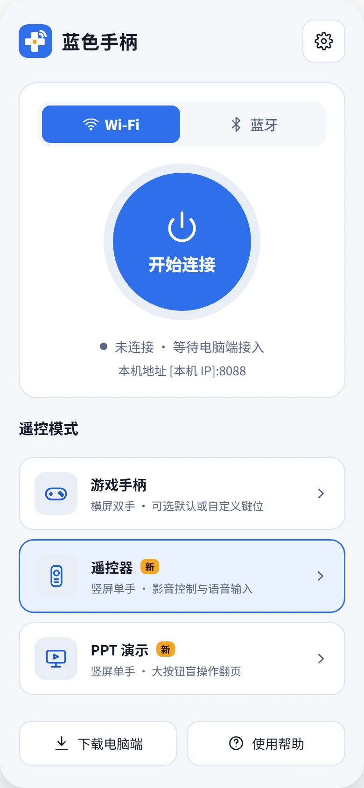
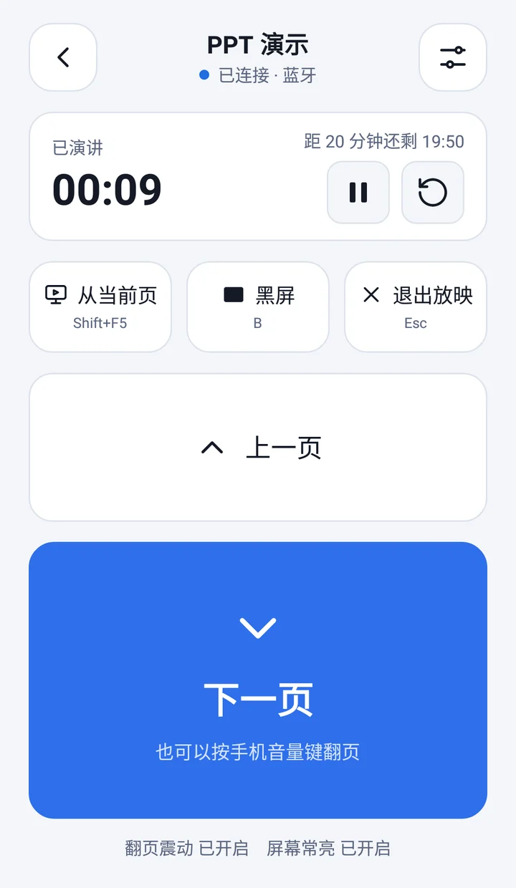
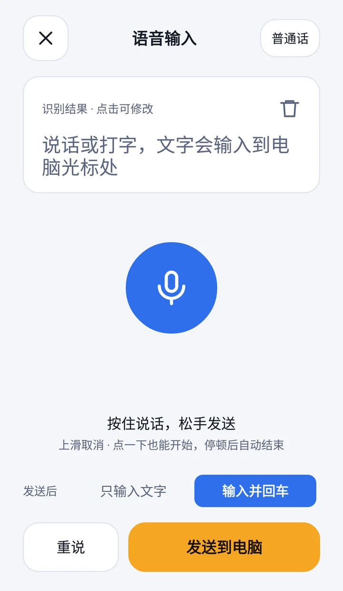
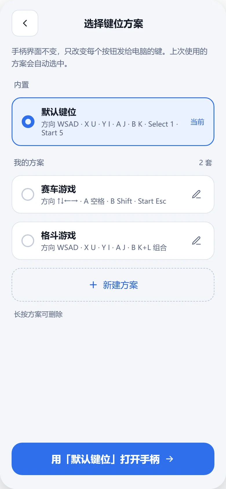
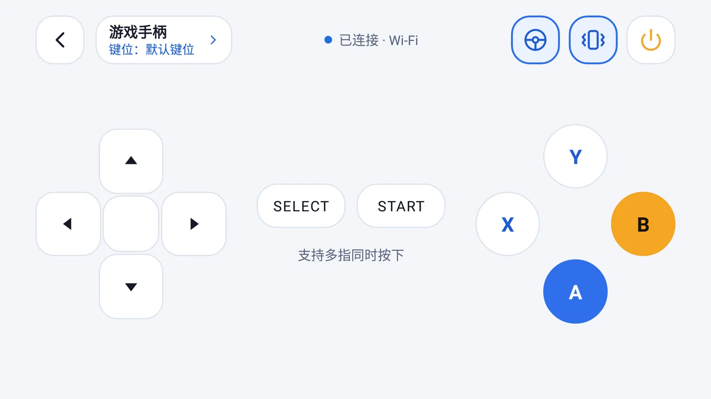
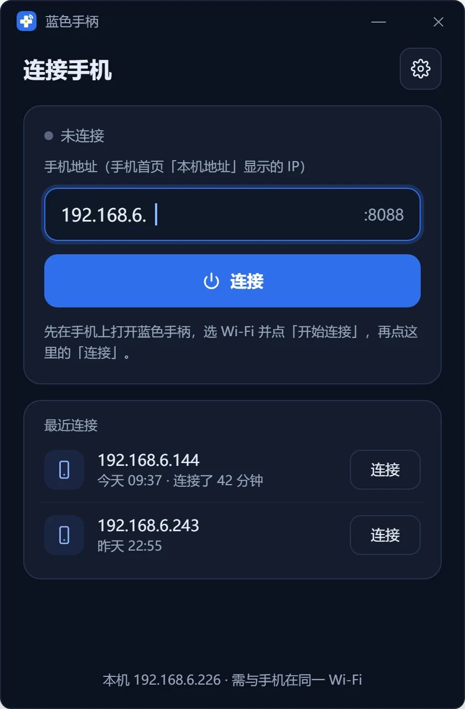
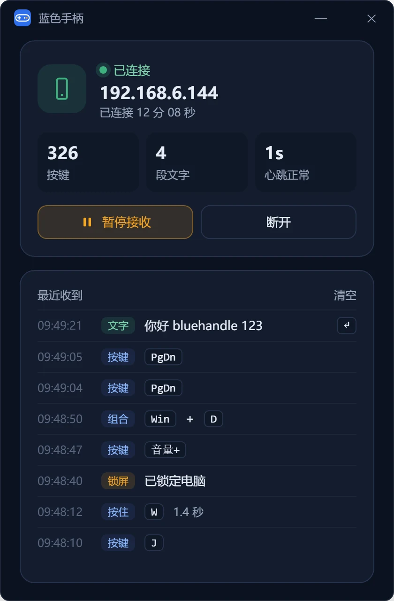

# 蓝色手柄

简体中文 | [English](README.en.md)

把手机变成电脑的手柄、遥控器和键盘。手机和电脑通过 Wi‑Fi 或蓝牙直连，不经过任何服务器。

  <picture><source media="(prefers-color-scheme: dark)" srcset="website/assets/screens/main.webp"></picture>
  <picture><source media="(prefers-color-scheme: dark)" srcset="website/assets/screens/ppt.webp"></picture>
  <picture><source media="(prefers-color-scheme: dark)" srcset="website/assets/screens/tvvoice.webp"></picture>
  <picture><source media="(prefers-color-scheme: dark)" srcset="website/assets/screens/gamepadscheme.webp"></picture>

  <picture><source media="(prefers-color-scheme: dark)" srcset="website/assets/screens/gamepad.webp"></picture>

- **游戏手柄**：横屏双手，方向键、A / B / X / Y、Select、Start；支持多指同时按、重力感应，可以给每个游戏建一套自己的键位方案，一个按钮最多 3 个键组合。
- **电脑遥控器**：竖屏单手，方向键、确定、返回、音量、媒体播放、锁屏、回到桌面、切换窗口、翻页，另有数字键盘。把电脑接上电视或投影，躺在沙发上就能操作。
- **PPT 演示**：大号翻页按钮，手机音量键也能翻页；演讲计时，剩余 2 分钟时震动提醒；从当前页放映、黑屏、退出放映一键完成。
- **语音输入**：按住说话，松手后文字直接输入到电脑当前光标处，可以自动按回车。

支持浅色和深色两种主题，默认跟随系统。

## 下载

需要手机端和电脑端都安装：

| | 下载 | 系统要求 |
|---|---|---|
| 手机端 | [GitHub Releases](https://github.com/bluehandle-open/bluehandle/releases/latest) | Android 4.1 及以上 |
| 电脑端 | [GitHub Releases](https://github.com/bluehandle-open/bluehandle-go/releases/latest) | Windows 10 / 11 |

电脑端源码在 [bluehandle-go](https://github.com/bluehandle-open/bluehandle-go)。

## 快速开始

1. 电脑上运行 `bluehandle.exe`。
2. 手机打开蓝色手柄，选择 Wi‑Fi 或蓝牙，点「开始连接」。
   - Wi‑Fi：手机和电脑连同一个网络，在电脑端输入手机首页显示的地址（默认端口 8088）。
   - 蓝牙：先在系统设置里把手机和电脑配对，再在电脑端的「蓝牙」列表里选择这部手机。
3. 连上后在首页选择一种用法。在各模式之间切换、回到首页，连接都不会断开。

  
  

完整说明见使用手册 [bluehandle.pages.dev/manual](https://bluehandle.pages.dev/manual)。

## 常见问题

**电脑端提示"连接超时"**

- 确认手机和电脑在同一个路由器下（电脑插网线、手机连 Wi‑Fi 也可以）。
- 路由器开了"访客网络"或"AP 隔离"时，设备之间无法互访，换主网络或关掉隔离。
- 电脑上的代理、VPN 或安全软件可能拦截局域网连接，可以先关掉试试。
- 手机的地址可能会变，以手机首页当前显示的为准。

**电脑端提示"手机拒绝了连接"**

电脑找到了手机，但手机没有在等待。在手机上点「开始连接」，并确认两边的端口一致。

**蓝牙列表里没有手机**

先在 Windows 设置里把手机和电脑配对，再在电脑端点「刷新」；手机首页要选「蓝牙」并点「开始连接」。

**连上了，但某个程序里按键没反应**

看电脑端"最近收到"里有没有这个按键：没有，是连接或手机端的问题；有，多半是目标程序以管理员身份运行，在电脑端设置里点「以管理员身份重启」。另外检查电脑端是否处于"暂停接收"。

**用着用着断开了**

手机熄屏或切到后台时，系统可能暂停应用。保持设置里的"屏幕常亮"开启，尽量让蓝色手柄留在前台。电脑端开着"意外断开后自动重连"时，手机重新点「开始连接」就会自动连回去。

**语音输入没反应**

首次使用要允许录音权限；手机没有语音识别服务时，在设置里把识别引擎改成"系统输入法"。文字会输入到电脑当前光标处，确认输入框已获得焦点。

**会上传我的数据吗？**

蓝色手柄本身不会。手机和电脑直接通信，不经过任何服务器。语音识别由手机自带的识别服务或输入法完成，是否联网取决于这些服务本身。

更多问题见使用手册的[常见问题](https://bluehandle.pages.dev/manual#faq)，或到 [Issues](https://github.com/bluehandle-open/bluehandle/issues) 反馈。

## 开发

- 编译需要 JDK 21：`./gradlew assembleDebug`
- 手机与电脑之间的通信协议见 [`docs/protocol.md`](docs/protocol.md)，电脑端仓库中有一份相同的文档。
- `website/` 是宣传页与使用手册（纯静态页面），`design/` 是设计稿和生成 logo、截图的脚本。
- 推送 `v*` tag 时，GitHub Actions 会编译、签名 APK 并发布 Release。

## 许可

[MIT](LICENSE)
